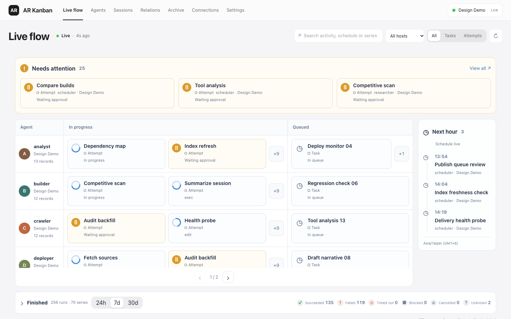
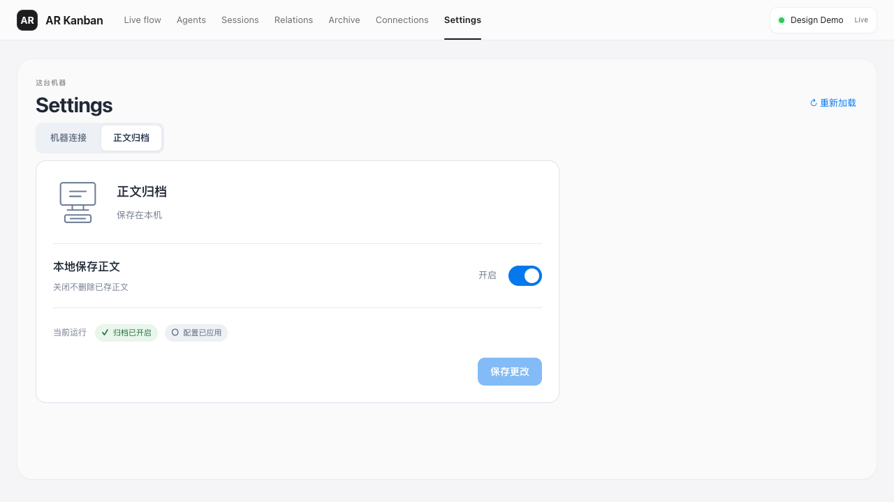
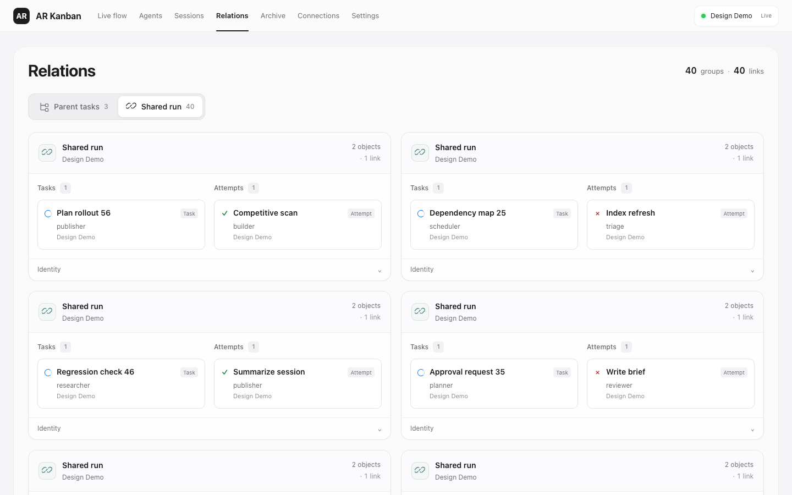
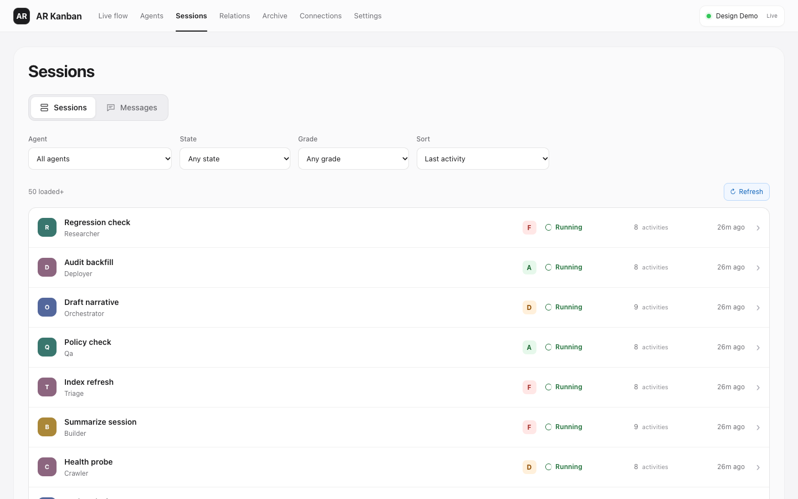
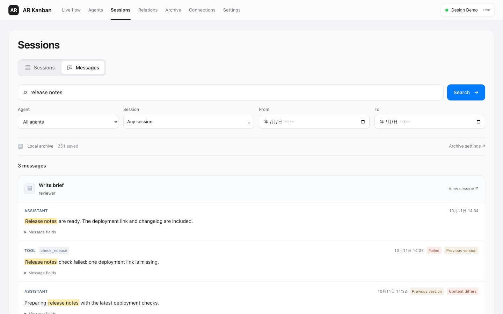
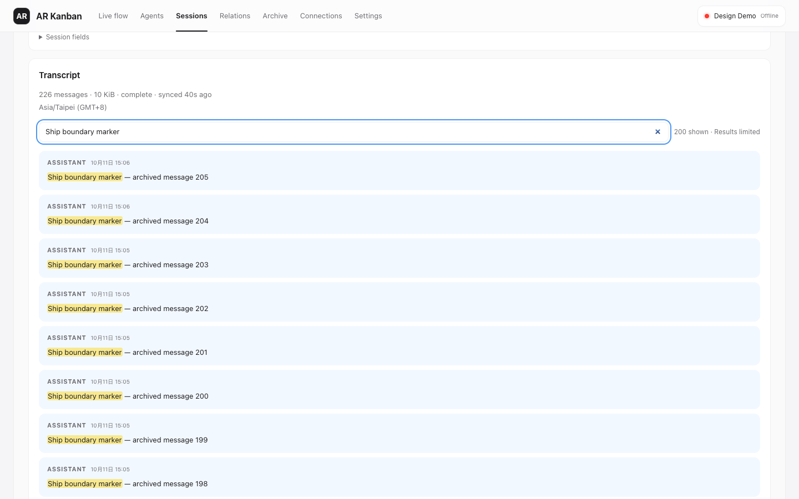
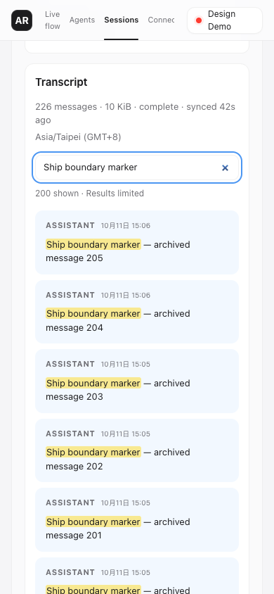
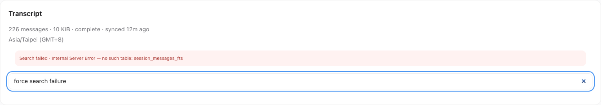
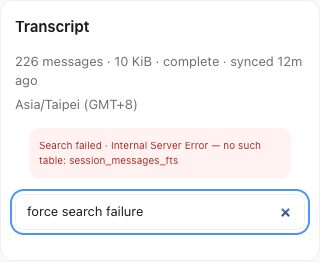

# Intuitive UI validation — 2026-10-11

The live board, settings, relations, session detail, and session search now use
layout, connections, state markers, and progressive disclosure to communicate
their primary meaning. Essential distinctions remain explicit: unknown outcomes,
shared-run associations, unavailable usage, local archive consent, and pending
restart are never presented as success, causality, zero cost, or applied settings.

## Verification

- Fresh `pnpm verify`: type checking, **620 tests in 49 files**, server build, and
  production web build passed after the final review fixes.
- Production Chrome checks covered 1440px, 1280px, and 390px viewports. The session
  list/search pass had 62 assertions; the relations/detail pass had 58. Archive
  opt-in, actual restart, retained offline search, and Hub limitations were also
  exercised with isolated Collector/Hub processes and temporary databases.
- The final production smoke pass checked navigation, deep links, board search
  persistence, inspector opening, and **one EventSource instance**, with no
  browser errors.
- Final review reproduced a real HTTP settings save and verified that `/meta`
  retains the startup host and Gateway while the saved choices await restart.
  Regression tests also cover a fresh runtime applying the saved choices, Cron
  source identity, and Hub snapshot/SSE epoch consistency.
- An isolated SQLite archive containing **205 matches** returned 200 with
  `truncated: true`. Desktop and 390px detail pages displayed
  `200 shown · Results limited`. Changing to a single-match query removed that
  flag; clearing restored the ordinary transcript. These checks had no browser
  or HTTP errors and no horizontal overflow.
- Session-detail search failures have a query-owned alert and do not display a
  zero-match count. Regression tests cover failure recovery, true zero results,
  stale rejections, and retaining unrelated transcript paging failures. Form
  and result validation now share one rule implementation, including the error
  priority for an empty query with an invalid date range.

All images below are unedited captures of the running production UI using mock
Gateway observations and isolated example archives. The main-view images were
captured during implementation; the detail boundary images were captured again
from the final review build. No real user config or conversation database was
used. Viewport checks are browser checks, not physical mobile-device acceptance.
The build still reports a JavaScript chunk above 500 kB (about 158 kB gzip).

## Live board

Active and queued work occupy separate columns; settled work has its own strip.
Agent lanes and compact state markers replace persistent rule paragraphs.

## Settings

Archive consent is a switch with an explicit save action. The applied runtime
state and any pending restart remain visible beside the choice.

## Relations

Parent-task trees and shared-run groups are separate modes. Shared membership
does not draw a parent-child arrow.

## Session list and message search

The session list shows names, state, grade, and usage in aligned rows. Session
filters and archive-message scopes retain independent URL state. Message scope
uses session names; raw references are available through disclosure.

## Session detail search boundary

The returned count is explicitly limited when the archive has more matches.
Both screenshots below come from real HTTP/SQLite search, with the Gateway
offline; no API response was intercepted or fabricated in the browser.

## Session detail search failure

These production UI panel captures use a separate temporary database. Renaming
its FTS index induced a real HTTP 500; restoring the index made the next query
succeed with three matches. Both viewport checks confirmed that the failed
request displays an alert without a result count, while a successful zero-hit
response still displays `0 matching messages`. Clearing search restored the
ordinary transcript. There was no browser response interception or unexpected
HTTP/page error.

