# Agents, Archive and Connections validation — 2026-10-11

Agents now use aligned status, 24-hour scores and the next-hour schedule, with
cost, seven-day scores and raw identities behind a disclosure. Archive uses
day groups, outcome symbols, intersecting search/filters and incremental rows.
Connections shows Gateway → Collector → Browser, or nodes → Hub → Browser,
with independent source and archive signals. Diagnostic details are folded.

## Verification

- Fresh `pnpm verify`: type checking, **690 tests in 57 files**, server build and
  production web build passed after the review fixes.
- **58 production Chrome checks** passed: 11 viewport checks, 39 interaction
  checks and 8 checks with the actual demo Gateway stopped. Coverage includes
  1440 × 900, 1280 × 720, 390 × 844 and intermediate widths 660, 720 and 820.
  No horizontal overflow, clipped primary actions or browser errors were found.
- `pnpm verify:views` passed navigation, deep links, back navigation, persistent
  board search, Inspector opening and exactly one EventSource instance.
- Regression tests cover unavailable sources without false Running/Idle,
  independent Cron coverage, owner-specific Hub uncertainty, the next-hour
  window, recent-history scope, fallback update times, same-name identities,
  polling without topic events, request ordering, cleanup and Inspector focus.
- CodeRabbit's two functional findings were fixed: retained activity no longer
  gives an unobservable Agent sorting priority, and page/archive status changes
  use stable polite live regions. DOM tests verify the announcement regions;
  actual VoiceOver output was not exercised.
- A separate static Gateway verified a real failed sync round and recovery
  with **zero inserted messages and zero session/message invalidations**.
  The page changed from Sync ready to Sync paused and back automatically,
  about 5.3 seconds after each actual status API transition. The Collector's
  existing 30-second background sync cadence precedes that frontend latency.

The main-view images are unedited captures of the final production build with
the project mock Gateway and isolated demo SQLite databases, using real
Collector/Hub HTTP and SSE. The sync-failure images record the separate API
acceptance round before the final sorting and live-region fixes, which preserve
the transcript refresh hook. Browser responses were not intercepted. Viewport checks do not claim
physical mobile-device or Safari acceptance. The existing JavaScript chunk-size
warning remains: about 545 kB raw / 164 kB gzip.

The browser-check details are in [viewport checks](visual-qa.json),
[interaction checks](interaction-qa.json), [offline checks](offline-qa.json) and
[status-only sync checks](status-only-qa.json).

## Agents

Unknown activity stays unknown. Historical scores remain visible while a source
is offline. Hub aggregate Cron availability cannot prove a particular node has
no schedule; only an observed forecast is shown for that node.

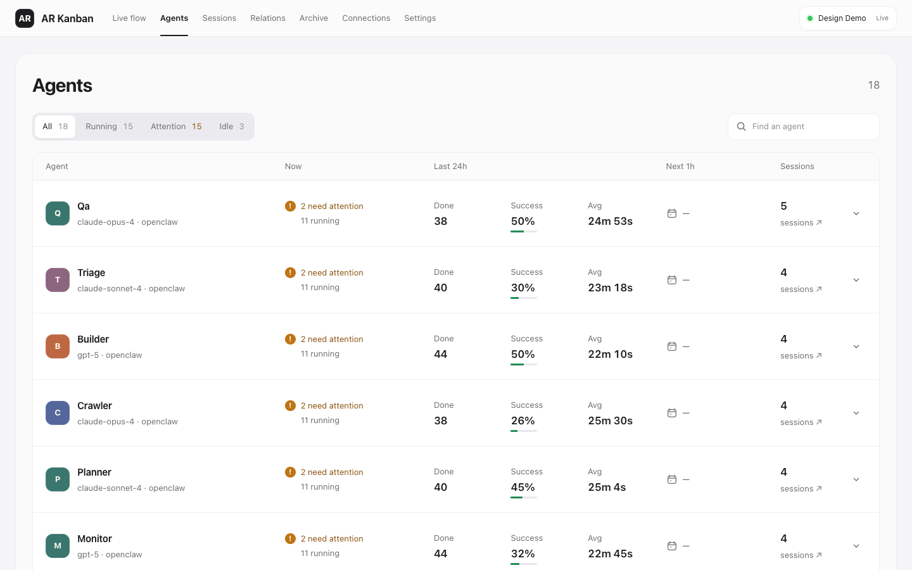

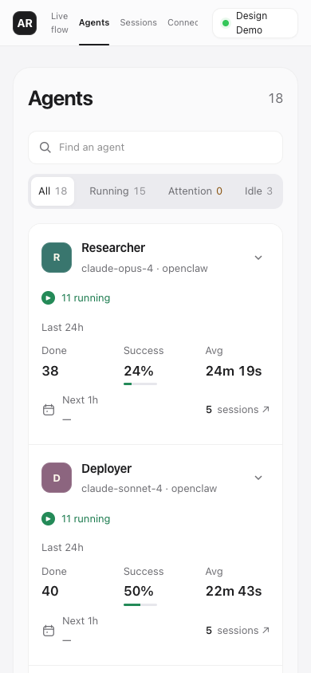

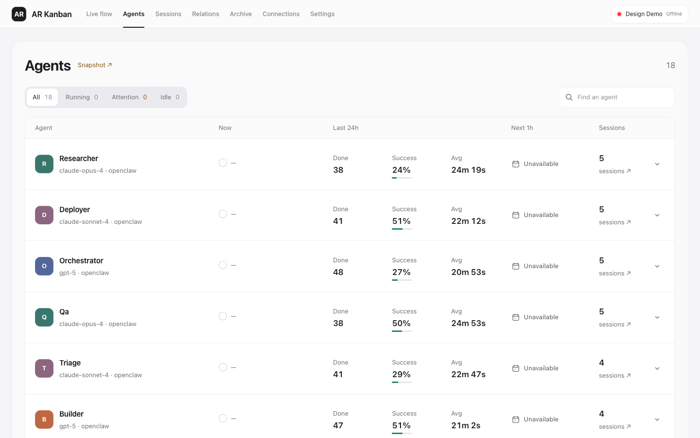

## Archive

The count describes recent snapshot history, rather than every row retained in
SQLite. Search, outcome and Agent filters intersect; pagination starts at 24.
Unknown and unreported outcomes remain distinct from success. Same-machine
same-name Agents are disambiguated consistently in both rows and filters.

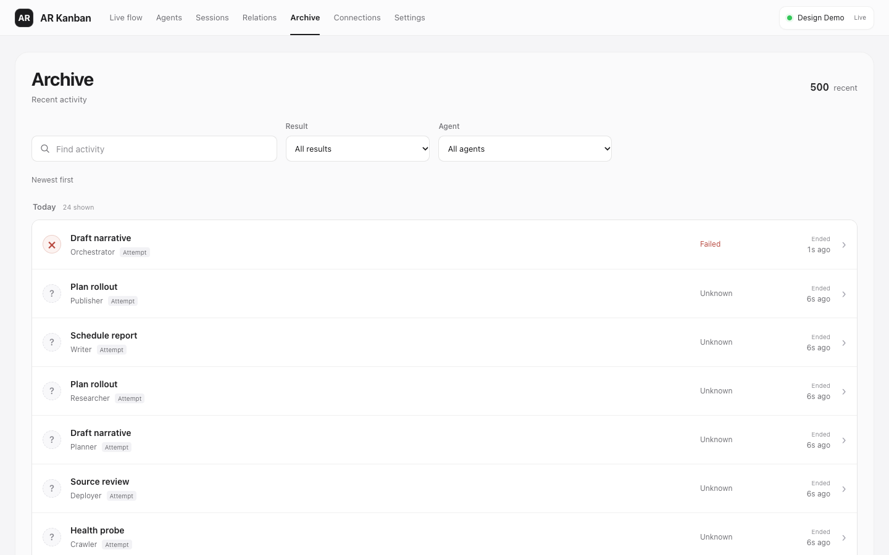

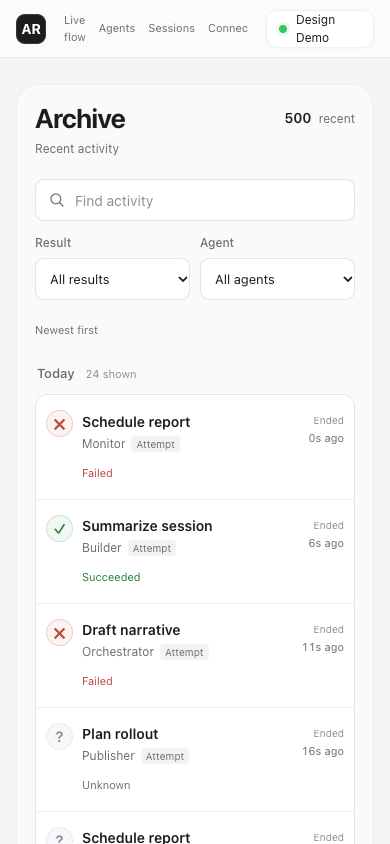

## Connections

Source connectivity and browser updates are independent. Saved-text disclosure
and file-access warnings remain visible; unsupported Hub archive requests are
avoided. Capacity is not inferred from text bytes divided by the database limit.
Archive status refreshes while visible even if no new messages arrive.

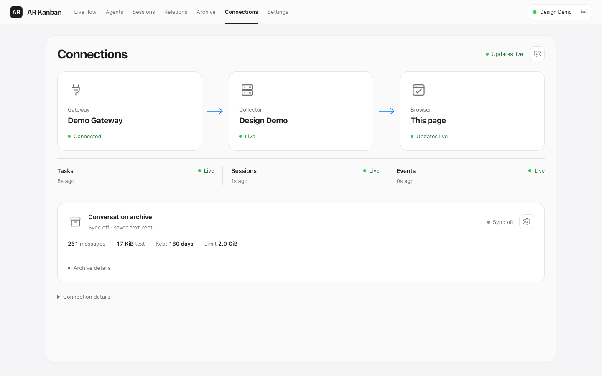

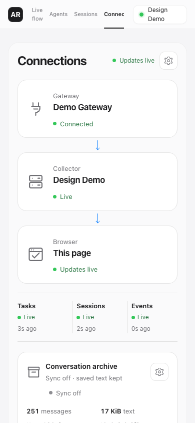

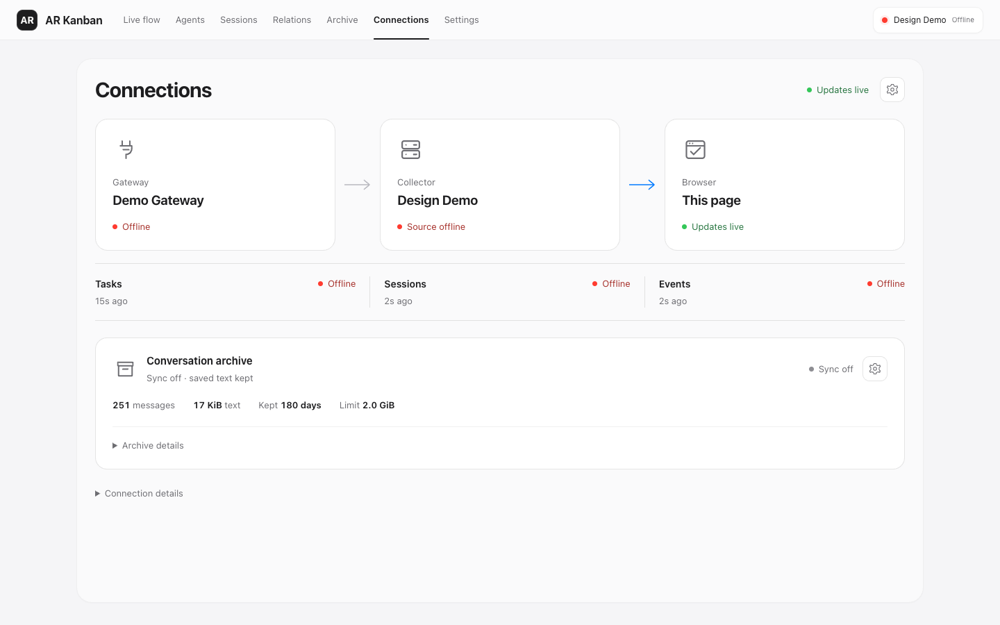

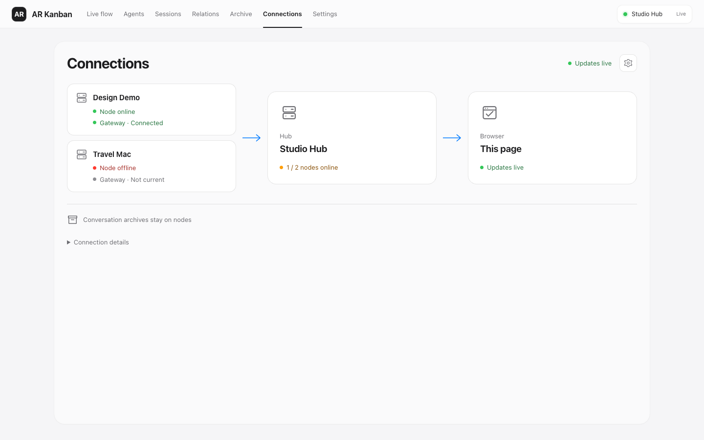

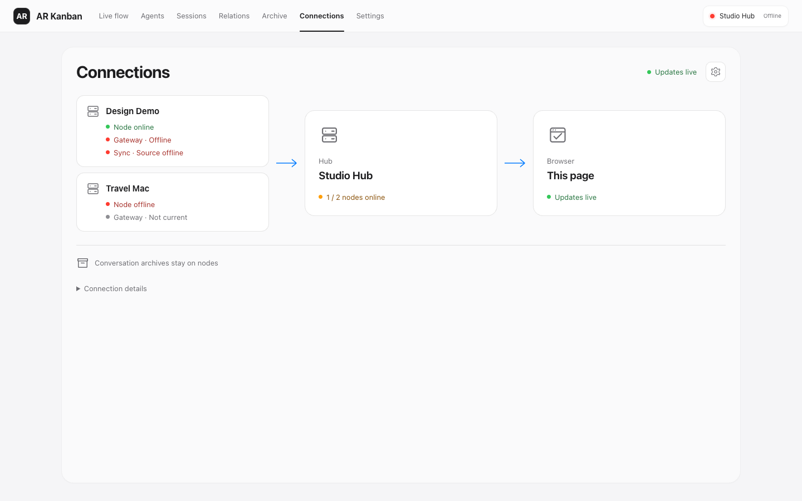

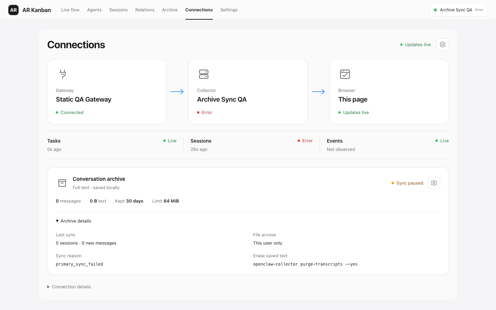

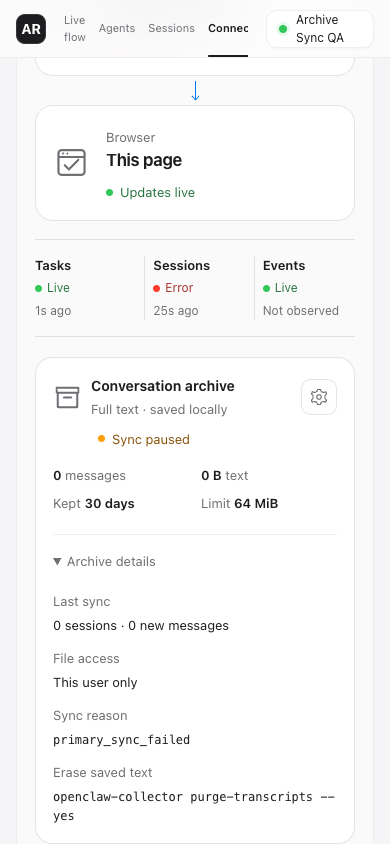
